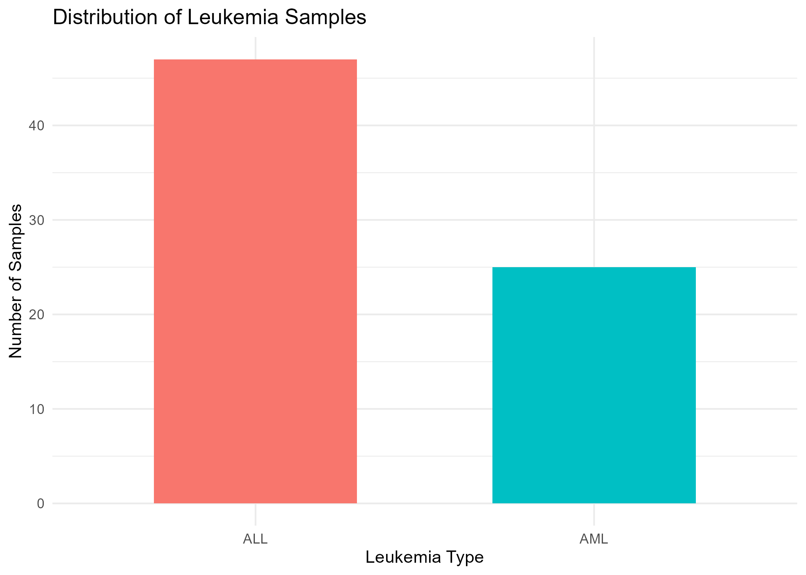
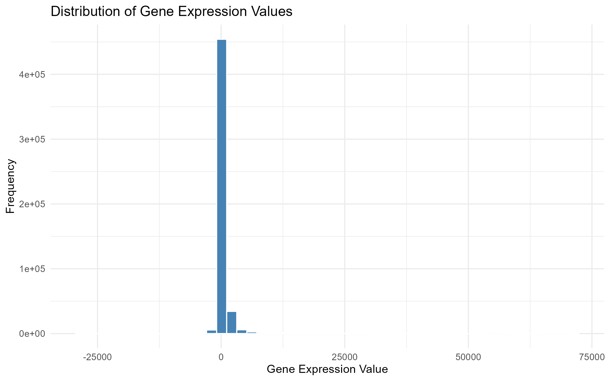
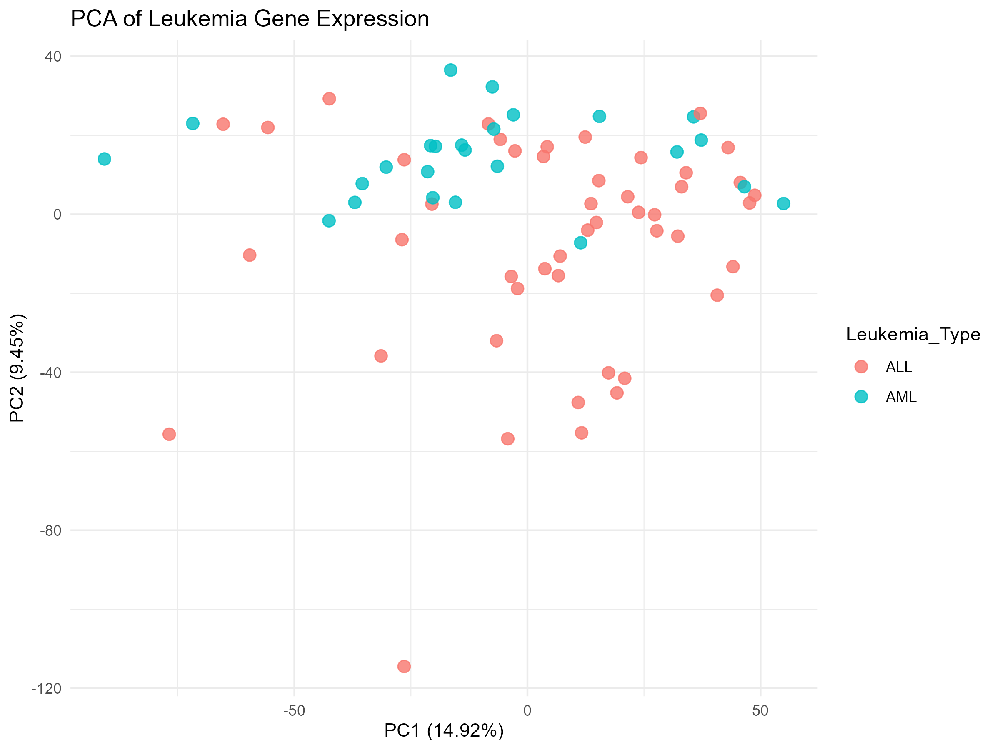
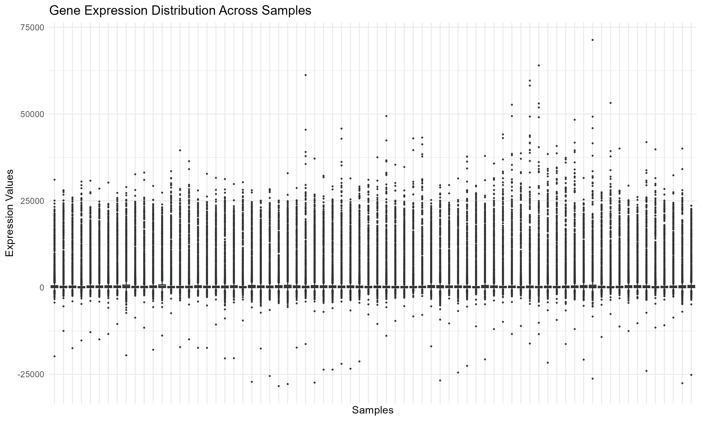
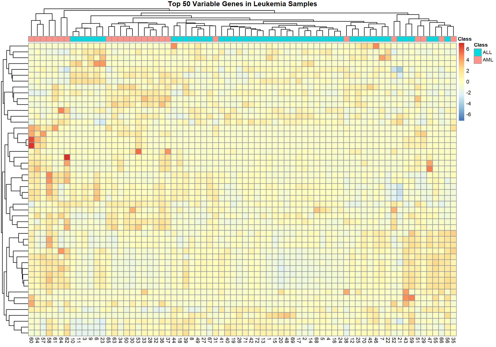
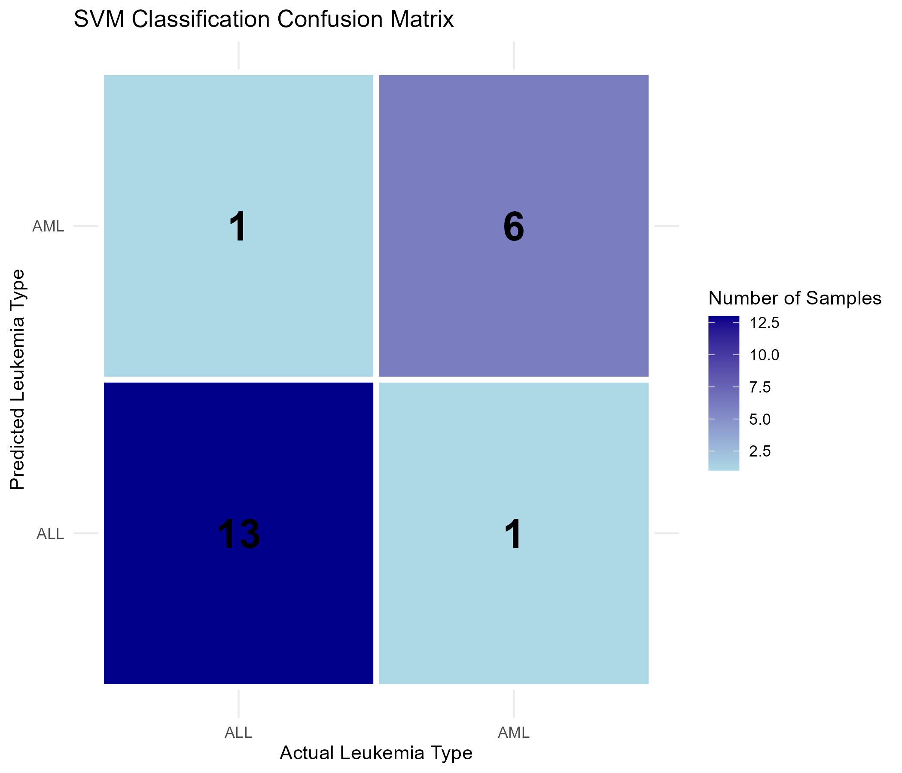
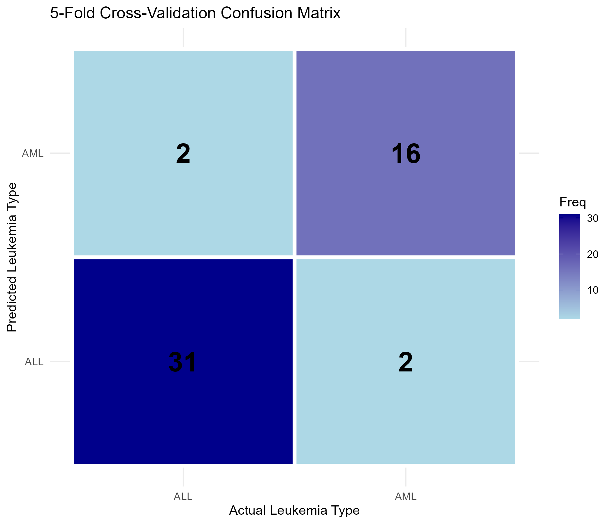

# Classification of Leukemia Types (ALL and AML) Using Gene Expression Data in R
## View Research Report
[Click here to view the full HTML Research Report](https://kanesanathanmukilan.github.io/2021-ASP-68/report/Leukemia_Research_Report.html)


## 1. Project Overview

This project investigates the classification of two important types of acute leukemia: Acute Lymphoblastic Leukemia (ALL) and Acute Myeloid Leukemia (AML). It uses publicly available gene expression data and machine learning techniques implemented in the R programming language.

The project follows a bioinformatics workflow that includes data collection, data import, quality checking, data cleaning, exploratory data analysis, dimensionality reduction, clustering, classification and model evaluation.

The main objective is to investigate whether gene expression patterns can be used to distinguish ALL samples from AML samples.

## 2. Abstract

Leukemia is a type of blood cancer that affects blood-forming tissues. Different leukemia types have different biological characteristics. This study investigates the use of gene expression data and machine learning for classifying ALL and AML. The Golub leukemia dataset was obtained through the Bioconductor package golubEsets. It contains 7,129 gene probes and 72 samples, including 47 ALL and 25 AML samples. Exploratory analysis was performed using statistical summaries, histograms, boxplots, Principal Component Analysis and a gene expression heatmap. A Support Vector Machine with a linear kernel was developed using the 100 most variable genes. The model achieved 90.48% accuracy on the held-out test set and 92.16% accuracy during five-fold cross-validation. These findings demonstrate the potential of gene expression analysis for leukemia classification. Further validation using independent datasets is required.

## 3. Research Problem and Motivation

Accurate classification of leukemia types is important because different leukemia types have different biological characteristics and treatment approaches. Gene expression analysis provides information about the activity of genes in biological samples.

High-dimensional gene expression datasets contain thousands of measurements for a relatively small number of samples. Analysing these datasets requires suitable statistical and computational techniques.

This project applies exploratory analysis and supervised machine learning to investigate the differences between ALL and AML. It also demonstrates a reproducible bioinformatics workflow using R.

## 4. Aim and Objectives

### Aim

To investigate the use of gene expression data and machine learning techniques to classify Acute Lymphoblastic Leukemia and Acute Myeloid Leukemia.

### Objectives

- Obtain a publicly available leukemia gene expression dataset.
- Import and examine the gene expression measurements and sample information.
- Perform data quality checks and prepare the dataset.
- Explore gene expression patterns using visualizations.
- Apply PCA and hierarchical clustering for exploratory analysis.
- Develop an SVM classification model.
- Evaluate classification performance using a test set and five-fold cross-validation.
- Discuss the results, limitations and possible improvements.

## 5. Dataset Description

This project uses the Golub leukemia dataset available through the Bioconductor package golubEsets. The dataset is associated with the research by Golub et al. (1999), which investigated cancer classification using gene expression monitoring.

The combined dataset contains 7,129 gene probes and 72 samples.

| Leukemia type | Number of samples |
|---|---:|
| Acute Lymphoblastic Leukemia (ALL) | 47 |
| Acute Myeloid Leukemia (AML) | 25 |
| Total | 72 |

The expression matrix contains gene expression measurements. The sample information contains the leukemia classification and additional metadata. The ALL.AML variable was selected as the target variable.

The dataset was imported in R using golubEsets and Biobase. The expression matrix was extracted using exprs(), and the sample information was obtained using pData().

## 6. Technologies and R Packages

The project was implemented using R and RStudio.

Main packages:

| Package | Purpose |
|---|---|
| golubEsets | Access the Golub leukemia dataset |
| Biobase | Work with Bioconductor expression data |
| tidyverse | Data manipulation and analysis |
| ggplot2 | Statistical visualizations |
| pheatmap | Gene expression heatmap |
| caret | Data partitioning and model evaluation |
| e1071 | Support Vector Machine classification |
| rmarkdown | Generate the research report |
| knitr | Render report content |

## 7. Data Preparation and Quality Checking

The dataset was checked for missing values, infinite values, duplicate probe identifiers and zero-variance genes.

The initial gene expression matrix contained no missing or infinite values. No duplicate probe identifiers were detected. Some optional metadata columns contained missing values, but these were retained because the classification target was available for all 72 samples.

The original and cleaned data were saved in CSV and RDS formats. The cleaned expression matrix and sample information were used in subsequent analysis.

## 8. Exploratory Data Analysis

Exploratory Data Analysis was performed to understand the sample distribution and gene expression patterns.

### 8.1 Sample Distribution

The dataset contains 47 ALL samples and 25 AML samples. A bar chart was generated to compare the number of samples in each category.



### 8.2 Gene Expression Distribution

A histogram was generated to examine the distribution of gene expression measurements across the dataset.



### 8.3 Principal Component Analysis

PCA was applied to explore major patterns in the gene expression dataset. The expression matrix was transposed so that samples were represented as rows and gene probes as columns. The first two principal components were visualized.



PCA is an exploratory dimensionality reduction method. The visualization helps investigate possible similarities and differences among samples. It is not the final classification model.

### 8.4 Gene Expression Boxplot

A boxplot was generated to compare the distribution of gene expression values across individual samples.



### 8.5 Gene Expression Heatmap

Gene expression variance was calculated for each probe. The 50 most variable genes were selected for visualization. Row-wise scaling and hierarchical clustering were applied.



The heatmap displays relative expression patterns across the samples and includes annotations for ALL and AML.

## 9. Machine Learning Classification

A Support Vector Machine classifier was developed to distinguish between ALL and AML. SVM is a supervised learning algorithm that constructs a decision boundary between classes.

### 9.1 Training and Testing

The dataset was divided into training and testing subsets using a 70:30 split.

| Dataset | Number of samples |
|---|---:|
| Training | 51 |
| Testing | 21 |

The 100 most variable genes were selected using the training data. The selected features were standardized using training data statistics, and the same scaling values were applied to the test data.

### 9.2 SVM Model

A linear SVM model was trained using the e1071 package. The cost parameter was set to 1. The trained model and its predictions were saved in the results folder.

## 10. Test-Set Evaluation

The trained model was evaluated using the 21 test samples.

### 10.1 Confusion Matrix

| Actual / Predicted | ALL | AML |
|---|---:|---:|
| ALL | 13 | 1 |
| AML | 1 | 6 |

The model correctly classified 13 ALL samples and 6 AML samples. One sample from each class was incorrectly classified.



### 10.2 Performance Metrics

| Metric | Result |
|---|---:|
| Accuracy | 90.48% |
| Sensitivity | 92.86% |
| Specificity | 85.71% |
| Balanced Accuracy | 89.29% |
| Cohen's Kappa | 0.7857 |

The model correctly classified 19 out of 21 test samples. The results indicate promising performance on this particular test split.

## 11. Five-Fold Cross-Validation

Five-fold cross-validation was performed using the 51 training samples. The training data were divided into five folds. In each iteration, four folds were used for training and the remaining fold was used for validation.

### 11.1 Cross-Validation Confusion Matrix

| Actual / Predicted | ALL | AML |
|---|---:|---:|
| ALL | 31 | 2 |
| AML | 2 | 16 |



### 11.2 Cross-Validation Metrics

| Metric | Result |
|---|---:|
| Accuracy | 92.16% |
| Sensitivity | 93.94% |
| Specificity | 88.89% |
| Balanced Accuracy | 91.41% |
| Cohen's Kappa | 0.8283 |

The five-fold cross-validation accuracy was 92.16%. This is an internal validation result using the training samples. It is separate from the held-out test accuracy of 90.48%.

## 12. Discussion

The results demonstrate that gene expression data can provide useful information for distinguishing between ALL and AML samples. The exploratory analysis helped examine the distribution of expression measurements and similarities among samples.

The linear SVM achieved 90.48% accuracy on the held-out test dataset. Five-fold cross-validation achieved 92.16% accuracy. Both results indicate promising performance within the available dataset.

However, the results should be interpreted carefully. The dataset contains only 72 samples and 7,129 gene probes. The high dimensionality and relatively small sample size can increase the risk of overfitting.

The 100 genes were selected using the full training split before cross-validation. Consequently, the cross-validation folds were not fully independent of feature selection. Nested cross-validation would provide a more rigorous evaluation.

The analysis also uses one dataset and one train-test split. Independent dataset validation is required to assess generalization to unseen samples.

## 13. Limitations

- The dataset contains a relatively small number of samples.
- The number of gene probes is much larger than the number of samples.
- The test-set evaluation uses only 21 samples.
- Feature selection was performed before cross-validation rather than separately within each fold.
- Only a linear SVM classifier was evaluated.
- Independent external validation was not performed.
- The model is an academic research prototype and is not a clinical diagnostic tool.

## 14. Future Work

Future improvements could include:

- Applying nested cross-validation to reduce feature-selection bias.
- Comparing SVM with Random Forest, Logistic Regression and other classifiers.
- Performing hyperparameter optimization.
- Evaluating the model using independent leukemia datasets.
- Investigating the biological significance of selected gene probes.
- Improving model interpretability.
- Examining additional feature selection methods.

## 15. Project Folder Structure

```text
Leukemia-Bioinformatics-Project/
|-- code/
|   |-- 01_data_import.R
|   |-- 02_data_cleaning.R
|   |-- 03_exploratory_analysis.R
|   |-- 04_expression_distribution.R
|   |-- 05_pca_analysis.R
|   |-- 06_expression_boxplot.R
|   |-- 07_gene_expression_heatmap.R
|   |-- 08_svm_classification.R
|   |-- 09_train_svm_model.R
|   |-- 10_confusion_matrix.R
|   |-- 11_cross_validation.R
|   |-- 12_cv_visualization.R
|-- data/
|-- figures/
|-- results/
|-- report/
|   |-- Leukemia_Research_Report.Rmd
|   |-- Leukemia_Research_Report.html
|-- README.md
```

The data folder contains the original and cleaned dataset files. The figures folder contains the generated visualizations. The results folder contains model predictions, performance results and saved model files.

## 16. Installation and Requirements

Install R and RStudio before running the project. The following commands install the main packages:

```r
install.packages(c('tidyverse', 'ggplot2', 'pheatmap', 'caret', 'e1071', 'rmarkdown', 'knitr'))
if (!requireNamespace('BiocManager', quietly = TRUE)) install.packages('BiocManager')
BiocManager::install(c('golubEsets', 'Biobase'))
```

Package installation may take some time. An internet connection is required for the initial installation.

## 17. How to Run the Project

Open the project root directory in RStudio. Run the scripts in the appropriate order.

1. Run 01_data_import.R to import the dataset.
2. Run 02_data_cleaning.R to perform data quality checks and prepare the data.
3. Run the EDA scripts to generate visualizations.
4. Run the classification preparation and SVM training scripts.
5. Run the confusion matrix and cross-validation scripts.
6. Render the research report using rmarkdown.

Some scripts depend on objects and files created by earlier scripts. Therefore, run them in order and ensure that the working directory is the project root.

## 18. Reproducibility

The project uses R scripts to document the analysis steps. A fixed random seed was used for the train-test split and cross-validation so that the corresponding partitioning and results can be reproduced under the same software and package conditions.

The cleaned datasets, figures, predictions, evaluation summaries and trained SVM model are stored in separate folders. The R Markdown report provides a documented description of the analysis.

## 19. Conclusion

This project investigated the classification of ALL and AML using publicly available gene expression data. Data preparation, exploratory analysis, PCA, hierarchical clustering, SVM classification and five-fold cross-validation were performed using R.

The SVM achieved 90.48% test accuracy and 92.16% cross-validation accuracy. These results demonstrate the potential of gene expression data for leukemia classification within the available dataset. Further validation using independent datasets and more rigorous feature-selection procedures is necessary.

## 20. References

1. Golub, T. R., Slonim, D. K., Tamayo, P., et al. (1999). Molecular classification of cancer: Class discovery and class prediction by gene expression monitoring. Science, 286(5439), 531-537. https://doi.org/10.1126/science.286.5439.531

2. Cortes, C., & Vapnik, V. (1995). Support-vector networks. Machine Learning, 20, 273-297. https://doi.org/10.1007/BF00994018

3. Bioconductor. golubEsets: Combined test and training sets from the Golub paper. Bioconductor package documentation.

4. R Core Team. R: A language and environment for statistical computing. R Foundation for Statistical Computing. https://www.r-project.org/

---

**Disclaimer:** This project is an academic bioinformatics study using a publicly available dataset. Its classification results should not be interpreted as evidence of clinical diagnostic performance.

