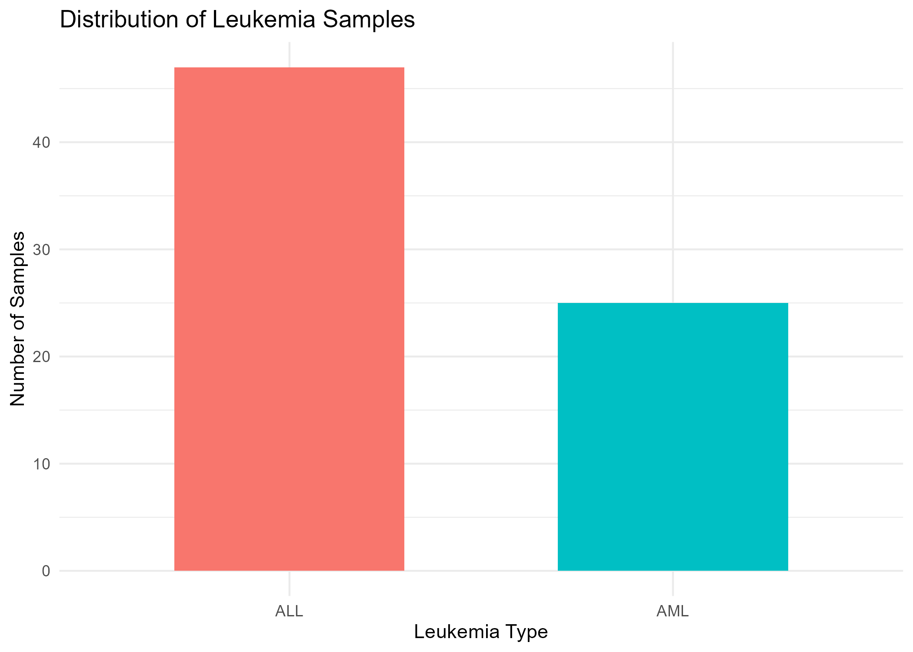
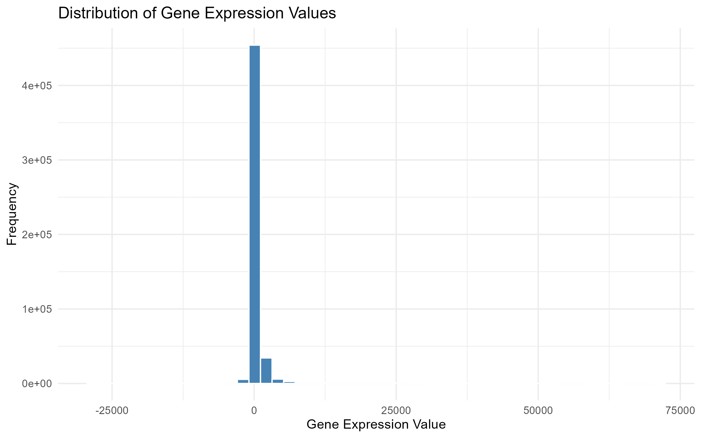
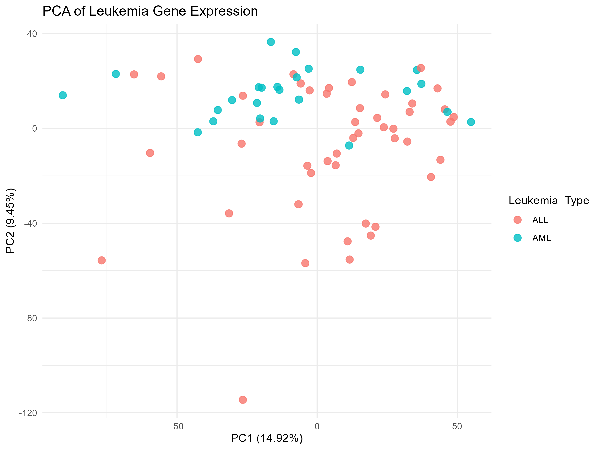
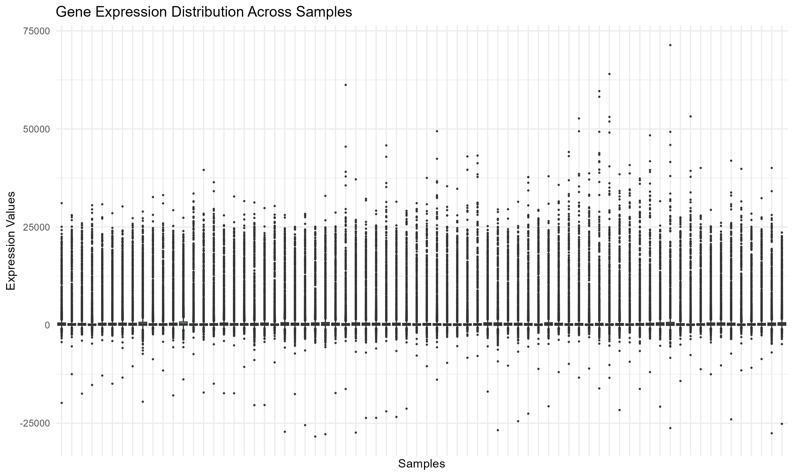
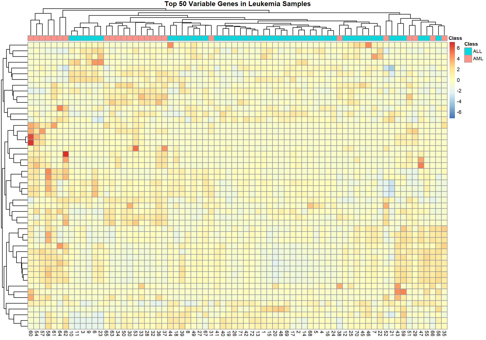
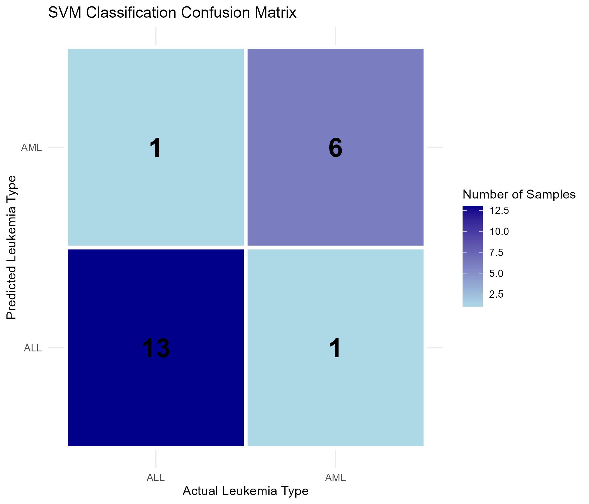
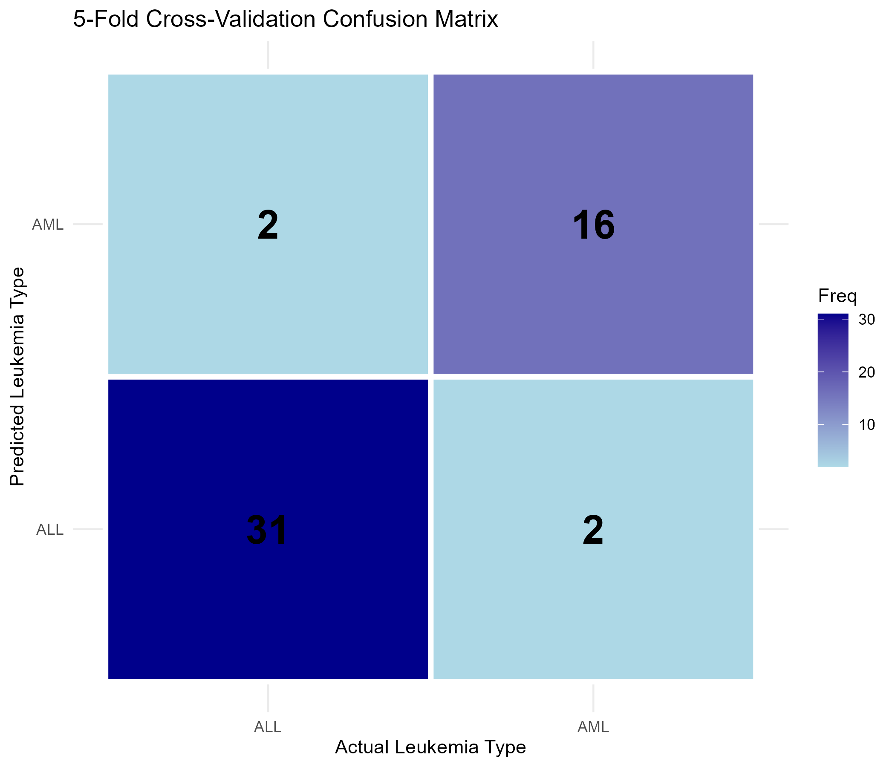

```{r setup, include=FALSE}
knitr::opts_chunk$set(echo = TRUE, warning = FALSE, message = FALSE)
library(ggplot2)
library(pheatmap)
```

# Abstract

Leukemia is a blood cancer that affects blood-forming tissues. This study investigates the classification of Acute Lymphoblastic Leukemia (ALL) and Acute Myeloid Leukemia (AML) using gene expression data and machine learning techniques in R. The Golub leukemia dataset, containing 7,129 gene probes and 72 samples, was used. Exploratory analysis included sample distribution, expression distribution, Principal Component Analysis (PCA), and hierarchical clustering heatmap visualization. A Support Vector Machine (SVM) with a linear kernel was developed using the 100 most variable genes. The model achieved 90.48% accuracy on the held-out test set and 92.16% accuracy during five-fold cross-validation. The findings demonstrate the potential of gene expression data for distinguishing between ALL and AML. Further validation using independent datasets is required.

# 1. Introduction

Leukemia is a group of cancers affecting blood and bone marrow. It develops when abnormal blood-forming cells grow uncontrollably and interfere with normal blood cell production.

Acute Lymphoblastic Leukemia (ALL) and Acute Myeloid Leukemia (AML) are two important types of acute leukemia. They develop from different blood cell lineages. Distinguishing between these types is important for disease classification and clinical investigation.

Gene expression data describe the activity levels of genes in biological samples. Different disease types may have different gene expression patterns. Computational analysis can therefore help identify patterns associated with particular disease classes.

This study applies exploratory data analysis and machine learning techniques to classify ALL and AML using publicly available gene expression data.

## 1.1 Aim

To investigate the use of gene expression data and machine learning techniques to classify ALL and AML.

## 1.2 Objectives

- Obtain and examine a publicly available leukemia gene expression dataset.
- Clean and prepare the gene expression data.
- Explore gene expression patterns using statistical and visualization techniques.
- Apply PCA and hierarchical clustering.
- Develop an SVM classification model.
- Evaluate the model using test-set evaluation and five-fold cross-validation.

# 2. Dataset Description

This study uses the Golub leukemia dataset available through the Bioconductor package `golubEsets`. The combined dataset contains 7,129 gene probes and 72 samples.

| Leukemia type | Number of samples |
|---|---:|
| ALL | 47 |
| AML | 25 |
| Total | 72 |

The expression matrix contains gene expression measurements, while the sample information includes the leukemia class and additional metadata. The `ALL.AML` variable was used as the classification target.

# 3. Data Preparation and Quality Checking

The dataset was imported in R using `golubEsets` and `Biobase`. The `exprs()` function was used to extract the expression matrix, and `pData()` was used to obtain sample information.

Initial quality checks found no missing or infinite values in the gene expression matrix and no duplicate probe identifiers. Some optional metadata columns contained missing values. These samples were retained because the classification target was available for all 72 samples.

The cleaned expression matrix and sample information were saved as CSV files.

# 4. Exploratory Data Analysis

Exploratory Data Analysis (EDA) was performed to understand the dataset and examine gene expression patterns.

## 4.1 Sample Distribution

The dataset contains 47 ALL samples and 25 AML samples.



## 4.2 Gene Expression Distribution

The histogram shows the frequency distribution of expression values across the gene expression matrix.



## 4.3 Principal Component Analysis

Principal Component Analysis (PCA) was applied to explore major patterns among samples. The expression matrix was transposed so that samples were represented as rows and gene probes as columns. The first two principal components were visualized.



PCA is used here as an exploratory technique. It does not itself establish classification accuracy.

## 4.4 Expression Boxplot

The boxplot compares gene expression distributions across the individual samples.



## 4.5 Gene Expression Heatmap

The 50 gene probes with the highest variance were selected for heatmap visualization. Row-wise scaling was applied, and hierarchical clustering was used to group genes and samples based on expression similarity.



# 5. SVM Classification Methodology

A Support Vector Machine (SVM) classifier with a linear kernel was developed to distinguish ALL from AML. SVM is a supervised learning algorithm that identifies a decision boundary between classes.

The dataset was divided into training and testing subsets using a 70:30 split. This resulted in 51 training samples and 21 testing samples.

The 100 most variable genes were selected using the training data. The selected features were standardized using the training data statistics. The same scaling values were applied to the testing data.

The SVM model was trained using the `e1071` package with a linear kernel and cost parameter of 1.

# 6. Classification Results

## 6.1 Test-set Confusion Matrix

The model was evaluated using the 21 samples in the test dataset.

| Actual / Predicted | ALL | AML |
|---|---:|---:|
| ALL | 13 | 1 |
| AML | 1 | 6 |

The model correctly classified 19 out of 21 test samples.



## 6.2 Test-set Performance

| Metric | Result |
|---|---:|
| Accuracy | 90.48% |
| Sensitivity | 92.86% |
| Specificity | 85.71% |
| Balanced Accuracy | 89.29% |
| Cohen's Kappa | 0.7857 |

The test-set accuracy of 90.48% indicates that 19 of the 21 samples were correctly classified. Sensitivity was 92.86%, while specificity was 85.71%.

# 7. Five-Fold Cross-Validation

Five-fold cross-validation was performed using the 51 training samples. The training data were divided into five groups. Each group was used for validation while the remaining groups were used to train the model.

The cross-validation confusion matrix was:

| Actual / Predicted | ALL | AML |
|---|---:|---:|
| ALL | 31 | 2 |
| AML | 2 | 16 |



## 7.1 Cross-Validation Performance

| Metric | Result |
|---|---:|
| Accuracy | 92.16% |
| Sensitivity | 93.94% |
| Specificity | 88.89% |
| Balanced Accuracy | 91.41% |
| Cohen's Kappa | 0.8283 |

The cross-validation accuracy was 92.16%. This is an internal validation result on the training data and is separate from the held-out test accuracy.

# 8. Discussion

The analysis demonstrates that gene expression data can be used to investigate differences between ALL and AML samples. The exploratory visualizations provided an overview of expression distributions, sample similarities and major patterns in the dataset.

The SVM model achieved 90.48% accuracy on the held-out test dataset. It correctly classified 13 ALL samples and 6 AML samples. One sample from each class was incorrectly classified.

Five-fold cross-validation achieved 92.16% accuracy and 91.41% balanced accuracy. These results indicate promising classification performance within this dataset.

However, the dataset contains only 72 samples and 7,129 gene probes. This high-dimensional structure can increase the risk of overfitting. In addition, the 100 genes were selected using the complete training split before cross-validation. Therefore, the validation folds were not fully independent of feature selection. Nested cross-validation would provide a more rigorous evaluation.

The model was evaluated using one train-test split and one dataset. Independent datasets and further validation are needed before considering the approach suitable for practical diagnostic use.

# 9. Conclusion and Future Work

This study investigated the classification of ALL and AML using gene expression data and an SVM model in R. The Golub dataset was used to perform data preparation, exploratory analysis, PCA, heatmap visualization and classification.

The SVM model achieved 90.48% accuracy on the held-out test set and 92.16% accuracy during five-fold cross-validation. These results demonstrate the potential of gene expression data for distinguishing between the two leukemia categories.

Future work could include nested cross-validation, comparison with Random Forest and Logistic Regression, independent dataset validation, biological investigation of selected genes and hyperparameter optimization.

# 10. Reproducibility

The analysis was implemented using R and RStudio. The main packages included `golubEsets`, `Biobase`, `tidyverse`, `ggplot2`, `pheatmap`, `caret` and `e1071`.

The project contains separate R scripts for data import, cleaning, exploratory analysis, PCA, heatmap generation, SVM classification, confusion matrix visualization and cross-validation. Figures and results are stored in separate folders.

# 11. References

1. Golub, T. R., Slonim, D. K., Tamayo, P., et al. (1999). Molecular classification of cancer: Class discovery and class prediction by gene expression monitoring. *Science, 286*(5439), 531-537. https://doi.org/10.1126/science.286.5439.531

2. Cortes, C., & Vapnik, V. (1995). Support-vector networks. *Machine Learning, 20*, 273-297. https://doi.org/10.1007/BF00994018

3. Bioconductor. `golubEsets`: Combined test and training sets from the Golub paper. Bioconductor package documentation.

4. R Core Team. *R: A language and environment for statistical computing*. R Foundation for Statistical Computing. https://www.r-project.org/

---

**Research limitation:** This project is an academic research prototype using a publicly available dataset. The results do not establish clinical diagnostic performance.
